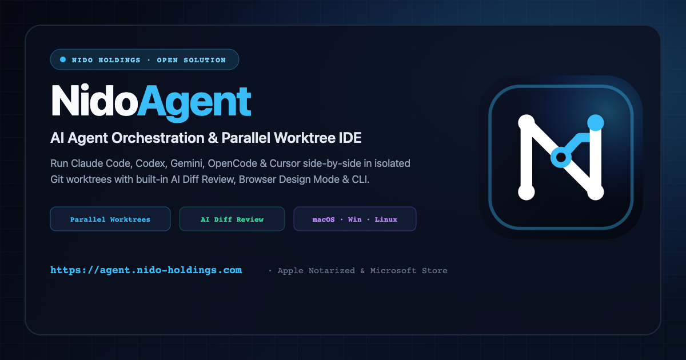

<p align="center">
  
</p>

# NidoAgent — Môi Trường Lập Trình AI Tự Trị & Native APM (Autonomous AI Coding IDE)

[](https://github.com/stevedat/nidoagent-releases/releases/latest)
[](https://github.com/stevedat/homebrew-tap)
[](https://nido-holdings.com/projects/nidoagent)
[](https://github.com/stevedat/nidoagent-releases/releases/latest)

**NidoAgent** là môi trường điều phối tác nhân lập trình AI tự trị (**Autonomous AI Coding IDE**) dành cho **macOS, Windows 10/11 và Linux**, tích hợp sẵn hệ thống giám sát lỗi nội bộ tốc độ cao **NidoPulse (Rustrak Native APM `:18080`)**, điều khiển trình giả lập di động **Android Emulator & iOS Simulator**, trình duyệt nhúng **NidoAgent CLI** và cầu nối điều khiển từ xa **NidoBridge** trên hệ sinh thái Apple (iPhone, iPad, Apple Watch, Apple TV).

---

## 📦 Tải Nhanh Bộ Cài Mới Nhất / Direct Downloads (Evergreen Links)

Các liên kết dưới đây luôn tự động trỏ tới phiên bản chính thức mới nhất (`Latest Release`):

| Hệ điều hành / Platform | Kiến trúc | Bộ cài trực tiếp / Direct Download | Ghi chú |
| :--- | :--- | :--- | :--- |
| **macOS (Apple Silicon)** | `arm64` (M1 / M2 / M3 / M4) | [**NidoAgent-mac-arm64.dmg**](https://github.com/stevedat/nidoagent-releases/releases/latest/download/NidoAgent-mac-arm64.dmg) | Đã ký số & Apple Notarized (`.dmg` — 285.3 MB) |
| **macOS (Intel)** | `x64` | [**NidoAgent-mac-x64.dmg**](https://github.com/stevedat/nidoagent-releases/releases/latest/download/NidoAgent-mac-x64.dmg) | Đã ký số & Apple Notarized (`.dmg` — 285.3 MB) |
| **Windows 10 / 11** | `x64` (64-bit) | [**NidoAgent-win-x64.exe**](https://github.com/stevedat/nidoagent-releases/releases/latest/download/NidoAgent-win-x64.exe) | Bộ cài chuẩn NSIS (`.exe` — 153.8 MB) |
| **Linux** | `x86_64` (`x64`) | [**NidoAgent-linux-x64.AppImage**](https://github.com/stevedat/nidoagent-releases/releases/latest/download/NidoAgent-linux-x64.AppImage) | Gói độc lập `AppImage` (178.1 MB) |

---

## ⚡ Cài Đặt Qua Homebrew (macOS)

```bash
brew install --cask stevedat/tap/nidoagent
```

Cập nhật lên phiên bản mới:
```bash
brew update && brew upgrade --cask nidoagent
```

---

## ✨ Năng Lực Cốt Lõi / Core Capabilities

- **Điều phối đa tác nhân song song trên Git Worktrees:** Vận hành đồng thời Claude Code, Codex, Gemini CLI, OpenCode, Cursor Agent, Pi và Aider trên các nhánh độc lập kèm trình so sánh Diff, kiểm thử GitHub Actions và tạo/gộp Pull Request trực tiếp.
- **NidoPulse / Rustrak Native APM (`localhost:18080`):** Đóng gói sẵn nhân Rustrak Native APM 34 MB chạy ngầm tự động cùng `rustrak-mcp-bridge` (79 công cụ MCP), hiển thị huy hiệu lỗi trực tiếp trên từng Repo ở Sidebar mà không cần Docker.
- **Auto-Healer & Zero-SDK Mobile Crash Catcher:** Tự động thu thập crash/exception từ Android Emulator (`adb logcat`), iOS Simulator (`xcrun simctl`) và Web/Backend, sau đó tự động điều phối Agent đang mở đọc stacktrace và vá lỗi (**Zero-Prompt Self-Healing**).
- **Điều khiển Trình giả lập Di động & Trình duyệt Nhúng (`nidoagent` CLI):** Cho phép Agent tương tác trực tiếp với Android Emulator, iOS Simulator (`nidoagent emulator ...`), cửa sổ ứng dụng máy tính (`nidoagent computer ...`) và trình duyệt nhúng (`nidoagent browser ...`).
- **NidoBridge & Hệ sinh thái Apple Remote:** Phê duyệt quyền truy cập của Agent, xem tiến độ thực thi và điều khiển phiên làm việc từ xa qua mạng nội bộ/Relay từ iPhone, iPad, Apple Watch và Apple TV.
- **Nido Skill Cloud Vault:** Khám phá, đóng gói và cài đặt 1 chạm các bộ kỹ năng (`SKILL.md`) qua giao thức `nidoagent://skills/share/<slug>`.

---

## 💎 Mô Hình Sử Dụng / Edition & Community Full Unlock

| Tính năng | Bản Tiêu Chuẩn (`Standard` — Tải về Miễn phí) | Bản Mở Khoá Cộng Đồng (`Community Full` — Miễn phí 100%) |
| :--- | :---: | :---: |
| **Điều phối đa Agent (Claude Code, Codex, Gemini, OpenCode...) & Git Worktrees** | ✅ Miễn phí trọn đời | ✅ |
| **NidoBridge Remote Control & Trình giả lập Mobile / Browser CLI (`nidoagent`)** | ✅ Miễn phí trọn đời | ✅ |
| **Bảng điều khiển NidoPulse Native APM (`localhost:18080`) & 79 MCP Tools** | ✅ Miễn phí trọn đời | ✅ |
| **Tự động sửa lỗi Zero-Prompt (`Auto-Healer` bơm thẳng vào phiên Agent đang chạy)** | 🔒 | ✅ **Mở khoá vĩnh viễn** |
| **Zero-SDK Mobile Crash Catcher (Tự bắt crash Android Emulator & iOS Simulator)** | 🔒 | ✅ **Mở khoá vĩnh viễn** |
| **1-Click Deep SDK Setup (Tự động gắn hook cho Flutter, Expo, Next.js, SvelteKit)** | 🔒 | ✅ **Mở khoá vĩnh viễn** |

> 💡 **Mở khoá `Community Full` hoàn toàn miễn phí:** Mở **NidoPulse Center** trong ứng dụng $\rightarrow$ bấm vào huy hiệu **`Standard · Mở khoá Full`** để lấy mã kích hoạt cộng đồng miễn phí (hoặc ủng hộ đội ngũ phát triển 1 ly cà phê tuỳ tâm).

---

## 🔐 Kiểm Chứng Toàn Vẹn Tệp / Verify SHA-256 Checksums

Mỗi bản phát hành đều đính kèm tệp [`SHA256SUMS.txt`](https://github.com/stevedat/nidoagent-releases/releases/latest/download/SHA256SUMS.txt). Bạn có thể kiểm tra chữ ký băm sau khi tải về:

```bash
shasum -a 256 -c SHA256SUMS.txt --ignore-missing
```

- 📦 **Danh sách toàn bộ các bản phát hành:** [GitHub Releases (`v1.0.0`, ...)](https://github.com/stevedat/nidoagent-releases/releases)
- 🌐 **Trang chủ dự án NidoAgent:** [https://nido-holdings.com/projects/nidoagent](https://nido-holdings.com/projects/nidoagent)
- 🐛 **Báo lỗi & Hỗ trợ kỹ thuật:** [GitHub Issues](https://github.com/stevedat/nidoagent-releases/issues)
